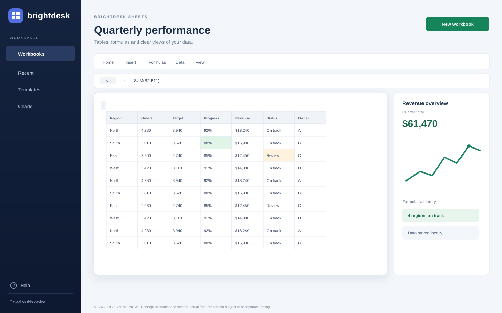

# Brightdesk Sheets

<strong>Work with tables, calculations, formulas and data.</strong>

Select the interface image to open the full-size design.

> **Interface design artwork — not a screenshot.** This image shows the intended Brightdesk interface. It is not a capture from the running desktop build. A genuine product screenshot will be added after the current desktop build has been launched and its primary workflow verified.

Brightdesk Sheets is a dedicated desktop application within the independent Brightdesk Office Suite. It uses the shared Brightdesk design language and opens directly into Sheets.

## Shared Brightdesk design standard

This product follows the [Brightdesk visual and interaction standard](https://github.com/connormolloy12/Brightdesk-suite/blob/main/docs/BRIGHTDESK_VISUAL_STANDARD.md) for branding, icon usage, layout, responsive behaviour and accessibility.

### Live interaction motion

The shared motion stylesheet now animates the entry of the document and product workspaces, the Get apps and Languages views, and native disclosure-panel content. Product buttons use the shared timing and easing scale while preserving the existing horizontal navigation hover treatment. Update checks and downloads show a decorative loading spinner beside the live status text; presentation mode uses the shared open/close overlay and closes immediately when reduced motion is requested.

## Shared motion foundation

This product bundles the canonical Brightdesk motion stylesheet locally at `src/motion.css`, loaded after `src/design-system.css`. Existing product controls use the shared fast timing and standard easing tokens (120 ms); the shared scale also defines 180 ms and 260 ms transitions. Reusable surface, interactive-control, overlay, progress and loading-indicator primitives are available for product-owned components.

The stylesheet is packaged with the desktop product and does not load from GitHub or another network service at runtime. The `prefers-reduced-motion: reduce` setting disables the shared transitions and spinner animation. Motion does not replace keyboard focus, accessibility semantics or component-specific state handling.

## Cross-platform consistency

The Windows, macOS and Linux editions use the same approved Brightdesk interface and supported product scope. Shared layout, typography, spacing, component states and navigation follow the [Brightdesk visual and interaction standard](https://github.com/connormolloy12/Brightdesk-suite/blob/main/docs/BRIGHTDESK_VISUAL_STANDARD.md). This product's original icon and approved accent remain the same on every operating system. Only operating-system integrations such as window controls, native file dialogs, keyboard conventions and package formats may adapt to platform conventions.

| Operating system | Configured package targets |
| --- | --- |
| Windows | x64 NSIS installer (.exe) |
| macOS | Universal disk image (.dmg), package installer (.pkg) and archive (.zip) |
| Linux | x64 AppImage (.AppImage) and Debian package (.deb) |

These are configured build targets, not confirmation that a package has passed its native build, installation, upgrade and removal checks. Each operating system must pass its own release verification before its download is described as available.

**Terms and first launch:** A valid acceptance of the current Brightdesk Terms and Conditions is required before the product opens. When no current acceptance record exists, a blocking agreement window is shown. Accept continues; declining or closing the window exits the product. This first-use gate is present in the product source for Windows, macOS and Linux. Follow any additional agreement shown by the native installer.

**Updates and removal:** The approved product version and feature scope must remain aligned across all operating systems. Update packages must come from the same tested release. Native installation and removal controls can differ by operating system, but the expected outcome is consistent: remove the product without silently deleting local project data. Do not claim update, upgrade or uninstall verification for an operating system until its native workflow has passed.

## Current first-use workflows

- Edit values in a spreadsheet grid and use the formula bar.
- Calculate basic arithmetic and supported range functions, including SUM, AVERAGE, MIN, MAX, COUNT and COUNTA.
- Add rows and columns, sort a selected column, and work with supported CSV and XLSX import/export.
- Keep the current workbook data on the device as part of the Brightdesk project.

**Known boundaries:** This is a basic spreadsheet foundation. Do not assume VBA/macros, pivot tables, advanced formula coverage, complex workbook features or exact Excel round-trip compatibility.
## Download

The latest desktop installers are published from this repository’s verified release workflow when a release is approved.

| Platform | Installer |
| --- | --- |
| Windows | Windows x64 installer (.exe) |
| macOS | Universal installer (.dmg), package (.pkg) and archive (.zip) |
| Linux | x64 AppImage and Debian package (.deb) |

The complete ten-product desktop suite remains available from [Brightdesk-suite](https://github.com/connormolloy12/Brightdesk-suite).

## Quality and security

Pull requests and pushes run the product and shared-engine test suite, verify the dependency lock and third-party licences, check release preflight and block high-severity dependency vulnerabilities. The same checks repeat daily. Dependabot checks npm packages and GitHub Actions weekly.

Installer builds are started manually. Publishing a GitHub Release is a separate manual choice and is disabled by default.

## Run from source

Use Node.js **24.22.2**.

    npm ci
    npm start

To build an installer on its native operating system:

    npm run dist:product:mac
    npm run verify:product:mac

Use win on Windows or linux on Linux instead of mac.

## Project structure

- src/ — Brightdesk desktop renderer and product modules.
- `assets/icons/sheets.svg` — original Brightdesk Sheets application icon.
- `assets/previews/sheets-workspace.svg` — workspace interface design.
- scripts/ — build and release verification tools.
- tests/ — automated product and shared-engine tests.

## Related project

[Brightdesk Office Suite](https://github.com/connormolloy12/Brightdesk-suite) brings all ten approved Brightdesk products together in one desktop installer.

## Identity and licence

Brightdesk is independent and is not affiliated with Microsoft. It uses original product names, code, interface design and artwork. See LICENSE, TERMS_AND_CONDITIONS.txt and THIRD_PARTY_NOTICES.md.

## CI and installer build cadence

Pull requests and pushes to `main` run the product validation job. Markdown-only changes are excluded from this test workflow because they do not change executable product code; the README freshness check remains responsible for documentation changes.

A scheduled maintenance validation runs every **Monday at 04:17 UTC**. The scheduled run performs product validation on Brightdesk's private macOS ARM64 runner, including release preflight and dependency audit; it does not create desktop installers.

The Windows, macOS and Linux installer matrix remains available through a manual workflow dispatch with `build_installers: true`. Publishing remains a separate opt-in action with `publish_release: true`. This keeps routine checks lighter without removing any operating-system build target or reducing cross-platform release coverage.

## Spreadsheet reference study

The [GridCraft reference study and Brightdesk Sheets roadmap](docs/GRIDCRAFT_REFERENCE_AND_SHEETS_ROADMAP.md) records feature research, the current verified first-use scope, proposed priorities, acceptance evidence and licensing boundaries. It is a development roadmap, not a claim of GridCraft or Excel parity.

## Documentation freshness

The root README is maintained alongside the product, not as an end-of-project task. Every pull request that changes application code, tests, UI, design assets, screenshots, icons, configuration, dependencies, packaging, or build/release workflows must also update this README in the same pull request. Keep feature status, screenshots and visual references, application icons, setup/build instructions, platform compatibility, and repository links aligned with the latest verified implementation. Describe planned or untested functionality as planned, never as completed. The **README freshness** GitHub Actions check requires a root `README.md` update whenever a pull request or direct push to `main` changes a non-Markdown file; a passing check confirms inclusion, while reviewers remain responsible for checking factual accuracy and current visuals.

## Customer network policy

Once installed, this product uses the internet only to check for, download and install official Brightdesk updates. The product does not provide separate in-product installer downloads, customer accounts, passwords, profiles, subscriptions, cloud storage or online services. Normal product work remains local and available offline. Initial installer distribution takes place outside the running product. Spelling checks run locally. Already-installed, integrity-verified dictionaries remain available offline. Entries that are not included in this build are catalogue information only and cannot be downloaded in-product. Future dictionary pack discovery, download and updates must use verified official Brightdesk resources; automatic hybrid fallback and the complete pack catalogue are still pending for this product.

## Private CI runner

Pull-request product tests and README checks run on Brightdesk's private macOS ARM64 runner. Routine pull-request verification does not use GitHub-hosted paid runners. Installer matrix builds and release publishing are separate manual workflow actions and are not run by pull-request checks.
